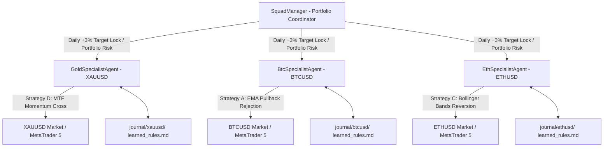

# 🤖 Multi-Agent Specialist Squad: Architecture & Responsibilities ("ใคร trade อะไร")

ระบบ Agentic Day Trading แบบแยกหน้าที่ Specialist ชัดเจนตามชนิดของสินทรัพย์ โดยแต่ละ Agent จะดูแลเพียง 1 สินทรัพย์อย่างสมบูรณ์แบบ มีกลยุทธ์ที่ผ่านการ Backtest ทางสถิติแล้วว่าดีที่สุด มี Rulebook และ Mistakes Database แยกอิสระจากกัน



---

## 1. ตารางบทบาทหน้าที่ (Who Trades What & Strategy Leaderboard)

| Specialist Agent | Symbol | สินทรัพย์ | กลยุทธ์ที่ชนะเลิศจากการ Backtest | ผลลัพธ์จากการทดสอบ (60-Day M15) | ขนาดสัญญา (Contract Size) | Stop-Loss Buffer ขั้นต่ำ | Journal & Rulebook |
|---|---|---|---|---|---|---|---|
| **GoldSpecialistAgent** | `XAUUSD` | ทองคำ (Gold) | **Strategy D: MTF Momentum Cross** | **+8.04% Return**<br>Win Rate: **74.1%**<br>Max DD: **5.21%** | 100.0 oz ($1 move = $100) | $2.00 (1.2 * ATR) | `journal/xauusd/` |
| **BtcSpecialistAgent** | `BTCUSD` | Bitcoin | **Strategy A: EMA Pullback Rejection** | **Hit 3% Target 10 วัน**<br>Win Rate: **48.9%**<br>Max DD: 30.17% | 1.0 BTC ($1 move = $1) | $50.00 (1.5 * ATR) | `journal/btcusd/` |
| **EthSpecialistAgent** | `ETHUSD` | Ethereum | **Strategy C: Bollinger Bands Reversion** | **+10.22% Return**<br>Win Rate: **48.4%**<br>Max DD: **3.28%** | 1.0 ETH ($1 move = $1) | $5.00 (1.5 * ATR) | `journal/ethusd/` |

---

## 2. รายละเอียด Specialist แต่ละตัว

### 🥇 1. GoldSpecialistAgent (`agents/gold_agent.py`)
- **Symbol**: `XAUUSD`
- **ลักษณะตลาด**: มีแนวโน้มแรง (High Trend Expansion) โดยเฉพาะช่วง London และ New York Session
- **กลยุทธ์ที่เลือก**: **Strategy D (MTF Momentum Cross)**
  - ใช้ EMA 200 บน Timeframe ใหญ่กรองเทรนด์หลัก (ห้าม Buy ใต้ EMA 200, ห้าม Sell เหนือ EMA 200)
  - รอสัญญาณ Golden / Death Cross ของ EMA 20/50 บน M15
  - ยืนยัน Momentum Expansion ด้วย RSI อยู่ในกรอบ 45–65
- **การคำนวณ Lot**: `Lot = (Equity * 1.5%) / (SL_Distance * 100)`

### ⚡ 2. BtcSpecialistAgent (`agents/btc_agent.py`)
- **Symbol**: `BTCUSD`
- **ลักษณะตลาด**: มีความผันผวนสูง มี Liquidation Spikes และการล่า Stop-Loss บ่อยครั้ง
- **กลยุทธ์ที่เลือก**: **Strategy A (EMA Pullback Rejection)**
  - ไม่ไล่ราคา รอให้เกิด Pullback ย่อตัวเข้าหาเส้น EMA 20 หรือ EMA 50
  - ต้องมี Candlestick Wick Rejection (Hammer / Pinbar) ปฏิเสธราคาที่เส้น EMA ก่อนเข้าออเดอร์เสมอ
  - ทำผลงานเด่นเรื่องการชนเป้าหมายกำไรรายวัน 3% ได้ถึง **10 วัน**
- **การคำนวณ Lot**: `Lot = (Equity * 1.5%) / (SL_Distance * 1.0)`

### 💎 3. EthSpecialistAgent (`agents/eth_agent.py`)
- **Symbol**: `ETHUSD`
- **ลักษณะตลาด**: มีพฤติกรรมแกว่งตัวแบบ Cyclical Mean-Reverting ภายในกรอบทางสถิติที่แม่นยำ
- **กลยุทธ์ที่เลือก**: **Strategy C (Bollinger Bands & RSI Mean Reversion)**
  - Buy เมื่อราคาแตะเส้นล่าง Bollinger Band (20, 2.0) ร่วมกับ RSI < 35
  - Sell เมื่อราคาแตะเส้นบน Bollinger Band ร่วมกับ RSI > 65
  - ทำกำไรสูงสุดในบรรดากลยุทธ์ทั้งหมดที่ **+10.22% Return** โดยมี Drawdown ต่ำมากเพียง **3.28%**
- **การคำนวณ Lot**: `Lot = (Equity * 1.5%) / (SL_Distance * 1.0)`

---

## 3. SquadManager: Portfolio Coordinator (`agents/squad_manager.py`)

ทำหน้าที่เป็นผู้บัญชาการพอร์ตภาพรวม (Master Portfolio Orchestrator):
1. **Portfolio Daily 3% Profit Target Lock**:
   - รวบรวม Realized PnL จาก Specialist ทั้ง 3 ตัวแบบ Real-time
   - เมื่อกำไรสุทธิรวมของวันแตะ +3.0% (เช่น $300 จากเงินต้น $10,000) ระบบจะสั่ง **PORTFOLIO_DAILY_TARGET_REACHED** และหยุดการออกออเดอร์ใหม่ของทุก Agent ทันทีเพื่อรักษากำไร
2. **Portfolio Daily Max Loss Cutoff**:
   - หากพอร์ตภาพรวมขาดทุนแตะ -2.0% หรือ -3.0% จะสั่งหยุดการเทรดทั้งทีมทันทีเพื่อคุ้มครองเงินทุน
3. **Rich Visual Dashboard**:
   - แสดงตารางสรุปสถานะของ Specialist แต่ละตัว, กลยุทธ์, กำไรวันนี้, และจำนวนไม้ที่เทรด

---

## 4. วิธีการสั่งงานผ่าน CLI

### รัน Squad ทั้งหมดพร้อมกัน (Gold + BTC + ETH):
```bash
# รันโหมด Paper Trading ตรวจสอบ 10 รอบ
python3 main.py run --agent=all --mode=paper --max-iter=10

# รันเชื่อมต่อ MetaTrader 5 (Exness Demo)
python3 main.py run --agent=all --mode=mt5 --interval=15
```

### รันเฉพาะ Specialist ตัวใดตัวหนึ่ง:
```bash
# รันเฉพาะ Gold
python3 main.py run --agent=gold --mode=mt5

# รันเฉพาะ Bitcoin
python3 main.py run --agent=btc --mode=mt5

# รันเฉพาะ Ethereum
python3 main.py run --agent=eth --mode=mt5
```

### ตรวจสอบสมุดบันทึกและกฎการเรียนรู้ (.md Journal):
```bash
# ดูสมุดบันทึกของทุก Agent
python3 main.py journal --asset=all

# ดูเฉพาะของ BTC หรือ ETH
python3 main.py journal --asset=btcusd
python3 main.py journal --asset=ethusd
```

### รัน Backtest เปรียบเทียบตลาด:
```bash
# รันเปรียบเทียบทุกตลาดและวาดกราฟ Multi-Panel Equity Curves
python3 main.py backtest --market=all

# รันเฉพาะตลาดใดตลาดหนึ่ง
python3 main.py backtest --market=eth
python3 main.py backtest --market=gold
```
