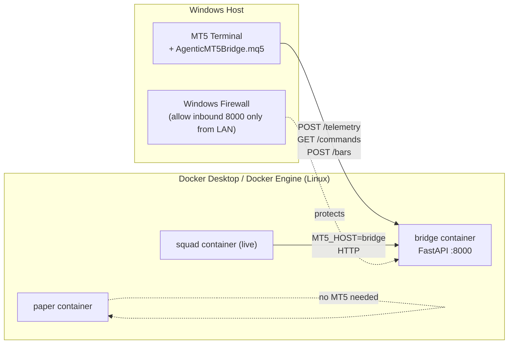

# 🐳 Running the Daytrad Stack on Docker (incl. Docker Desktop for Windows)

This project uses an **HTTP bridge architecture**:



Critical: `MetaTrader5` is a **Windows-only native application**. The EA **cannot** run inside a Linux container. Docker here runs only the "brain" (Python logic, FastAPI bridge, ML, dashboards).

---

## 1. Topology

| Service  | Purpose                              | Runs on            | Auto-start with `docker compose up` |
|----------|--------------------------------------|--------------------|-------------------------------------|
| `bridge` | FastAPI REST/Web dashboard on :8000  | Docker container   | ✅ always                            |
| `squad`  | Live trading loop (all specialists)  | Docker container   | ⚠️ only with `--profile live`        |
| `paper`  | Simulated trading (no MT5)           | Docker container   | ⚠️ only with `--profile paper`       |
| `dev`    | Idle shell for analysis/tests/backtests against the live bridge (never trades on its own) | Docker container | ⚠️ only with `--profile dev` |
| `AgenticMT5Bridge.mq5` | MT5 Expert Advisor  | **Windows host** (native) | manual |

---

## 2. Quick Start

```bash
# 1. Build image once
docker compose build

# 2. Safe: Paper trading (no broker)
docker compose --profile paper run --rm paper

# 3. Live: Start bridge
docker compose up -d bridge

# 4. Live: Start the trading squad (DANGER: real orders)
docker compose --profile live up -d squad

# 5. Dev: bridge + idle shell for analysis/backtests (no autonomous trading)
docker compose --profile dev up -d
docker exec -it agentic_dev python3 main.py run --agent=gold --mode=paper --max-iter=1
```

---

## 3. Windows-Specific Notes (Docker Desktop)

On Docker Desktop for Windows the container lives inside a hidden WSL2 VM. `localhost` on Windows **does not** reach the container by default in a way that the MT5 `WebRequest()` function accepts reliably (IPv6 `::1` resolution and firewall heuristics cause sporadic `4014/4060` errors).

### 3.1 Configure Windows Firewall

Open an elevated PowerShell and **allow inbound TCP 8000 only from your local LAN** (adjust subnet to yours):

```powershell
New-NetFirewallRule -DisplayName "Docker MT5 Bridge (LAN only)" `
  -Direction Inbound -Protocol TCP -LocalPort 8000 `
  -RemoteAddress 192.168.0.0/16,10.0.0.0/8,172.16.0.0/12,127.0.0.1 `
  -Action Allow
```

This keeps the bridge off the public internet while letting the Windows MT5 EA reach it.

### 3.2 Get your Windows host LAN IP

```powershell
ipconfig | findstr /R "IPv4"
# Example output: IPv4 Address. . . . . . . . . . . : 192.168.1.42
```

Use **that** IP (e.g. `http://192.168.1.42:8000`) — **not** `http://localhost:8000` — in the MT5 EA.

### 3.3 Configure MT5 WebRequest Allowlist

In MetaTrader 5 (Windows):

1. Open **Tools → Options → Expert Advisors**
2. Check **"Allow WebRequest for listed URL"**
3. Add the address from step 3.2, e.g.:
   ```
   http://192.168.1.42:8000
   ```
4. (Optional, for same-machine testing) also add `http://127.0.0.1:8000` — useful only if you run the bridge natively on Windows instead of in Docker.
5. Restart MT5.

### 3.4 Update EA `InpServerUrl`

Edit `mt5/AgenticMT5Bridge.mq5` **input** before attaching the EA:

```mql5
input string InpServerUrl = "http://192.168.1.42:8000"; // <-- your Windows host LAN IP
```

or set it in the EA's **Inputs** tab after attaching it to a chart.

---

## 4. Healthcheck & Logs

The `bridge` container now has an HTTP healthcheck (`GET /api/mt5/status`).

```bash
# Container health status
docker compose ps

# Live logs
docker compose logs -f bridge

# Squad waits for bridge to be "healthy" before trading (depends_on: service_healthy)
```

---

## 5. Image Defaults

A plain `docker run <image>` (no command) now starts a **5-iteration paper simulation** and exits cleanly. This avoids both accidental live trading and the old behavior of printing only `--help`.

Override as shown in §2 for real deployments.

---

## 6. Troubleshooting

| Symptom | Fix |
|---------|-----|
| EA logs `WebRequest error 4014 / 4060` | URL not in allowlist (§3.3) OR using `localhost` instead of host LAN IP (§3.2) |
| `docker compose up squad` does nothing | Squad is in the `live` profile: `docker compose --profile live up squad` |
| Squad starts, then immediately stops | Bridge not healthy yet; it now has `depends_on: condition: service_healthy` — check `docker compose logs bridge` |
| No market data / stale bars | EA not pushing bars; check MT5 Experts tab, `InpServerUrl`, and port 8000 reachability |
| Dashboard shows nothing | Open `http://<host-LAN-IP>:8000` from a browser on the **same LAN** (or `localhost:8000` on the Docker host) |
| Permission errors writing to `./journal` / `./data` | Ensure those host folders exist and your user owns them before `docker compose up` |

---

## 7. Why the port is bound to `0.0.0.0:8000` (not `127.0.0.1`)

The old `127.0.0.1:8000:8000` mapping made the bridge reachable only **from the Docker host itself**. The design goal is for a separate Windows MT5 terminal to push telemetry, so the published port must accept connections from other machines on the LAN. The firewall rule in §3.1 restores the appropriate boundary.
