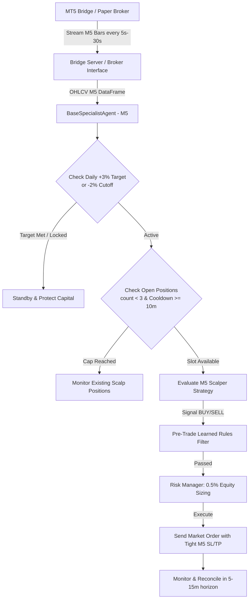

# M5 High-Frequency Scalping Trading System Design Spec

## 1. Overview & Objective
- **Current State:** The multi-agent trading squad (Gold, BTC, ETH) operates on the M15 timeframe using conservative macro trend-following and mean-reversion strategies. Settle-in and cross signals occur infrequently (1–3 times per day), leaving long idle periods.
- **Target Goal:** Achieve high-frequency entries on **M5** targeting **approximately 1 order every 10 minutes** across active market periods (~every 2 M5 bars), allowing up to 2–3 concurrent scalp positions per asset, with rapid profit taking (5–15 min holding time) while strictly maintaining the Portfolio Daily +3% Profit Lock and -2% Loss Cutoff.

---

## 2. Architecture & Core Changes

### 2.1 Multi-Signal M5 Scalper Engine (`backtest/strategies.py`)
Rather than waiting for rare multi-hour crossings, each asset specialist deploys an active M5 Scalper with 3 trigger modalities:
1. **Pullback Continuation:**
   - Detects established micro-trend using Fast EMAs (EMA 9, EMA 21) and baseline EMA 100/200.
   - Triggers entry when price retraces to touch EMA 9/21 and prints a directional rejection/continuation candle.
2. **Micro Range Breakout:**
   - Triggers when price closes beyond the 5-bar high (for BUY) or 5-bar low (for SELL) with expanding ATR or RSI momentum confirmation.
3. **Micro Cross Cycle:**
   - Triggers on fresh EMA 9 / EMA 21 cross with momentum confirmation.

### 2.2 Dynamic Scalp SL/TP & M5 Risk Tuning
On M5, Average True Range (ATR 14) is roughly 1/3 to 1/2 of M15 ATR. Therefore:
- **Gold (XAUUSD):**
  - Minimum SL distance reduced from $2.00 to $0.80.
  - SL = $1.0 \times \text{ATR}$, TP = $1.5 \times \text{ATR}$ (RR 1:1.5).
- **Bitcoin (BTCUSD):**
  - Minimum SL distance reduced from $50.00 to $25.00.
  - SL = $1.2 \times \text{ATR}$, TP = $1.8 \times \text{ATR}$.
- **Ethereum (ETHUSD):**
  - Minimum SL distance reduced from $5.00 to $2.00.
  - SL = $1.2 \times \text{ATR}$, TP = $1.8 \times \text{ATR}$.
- **Risk Sizing:**
  - `risk_per_trade_pct` set to 0.5% (0.005) so that having 3 open positions consumes at most 1.5% risk, safely below the 2.0% daily maximum loss cutoff.

### 2.3 Concurrent Positions & 10-Minute Cooldown (`agents/base_agent.py`)
- Previously, `len(symbol_positions) >= 1` blocked any new trade while one was running.
- Updated logic allows `len(symbol_positions) < max_open_positions` (default = 3).
- **10-Minute Cadence Cooldown:**
  - A minimum cooldown of 2 M5 bars (10 minutes) between new entries on the same symbol, or a requirement that the entry price differs from existing open positions by at least $1.0 \times \text{ATR}$, preventing duplicate entries on the same tick.

### 2.4 MT5 Bridge & Data Pipeline Integration
- In `mt5/AgenticMT5Bridge.mq5`:
  - Update `SendMarketBars` to support dynamic timeframe string (replace hardcoded `"timeframe":"M15"` with dynamically resolved string like `"M5"`).
  - Add input `InpTimeframe = PERIOD_M5` (default) with selectable options.
- In `mt5/bridge_server.py`:
  - Ensure bar storage and `/api/mt5/bars` handle `M5` seamlessly.
- In `config.py` & CLI (`main.py`):
  - Add `--timeframe` argument (default `"M5"`).
  - Pass timeframe through `SquadManager` to specialist agents.

---

## 3. Data Flow & Execution Lifecycle

---

## 4. Testing & Verification Plan
1. **Unit Tests:**
   - Test M5 scalper strategy signals (Pullback, Breakout, Cross) with synthetic M5 data.
   - Test `BaseSpecialistAgent` with `max_open_positions = 3` and 10-minute cooldown behavior.
   - Test risk manager SL/TP calculations with M5 ATR inputs.
2. **Backtesting:**
   - Run backtests on M5 historical data for Gold, BTC, and ETH.
   - Verify trade count and frequency (~several trades per day up to 1 trade per 10-20 minutes during volatile hours).
   - Evaluate Win Rate, Profit Factor, and Daily Target Hit rate.
3. **CLI & Live Simulation Test:**
   - Run `python3 main.py run --agent=all --mode=paper --timeframe=M5 --max-iter=5` to verify end-to-end execution without errors.
