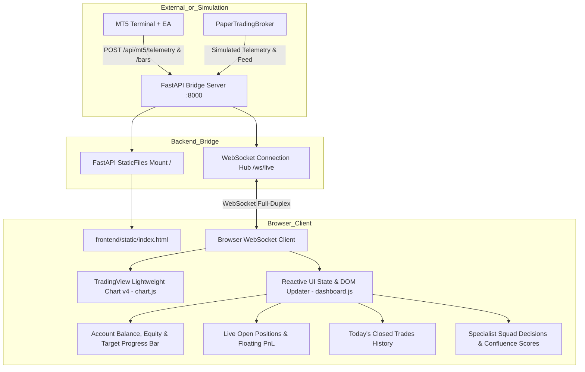

# Spec: Real-time Web Frontend Dashboard (MT5 Replacement)

**Date**: 2026-09-23  
**Status**: Approved  
**Scope**: Read-Only / Live Monitoring Dashboard  

---

## 1. Executive Summary

This specification defines a real-time web frontend dashboard for the Pilotfish Agentic Day Trading platform to serve as an in-browser replacement for MetaTrader 5 (MT5). The dashboard provides ultra-low-latency monitoring of live market prices, interactive candlestick charts, account KPIs, progress toward daily profit targets (+3.0% / +10.0%) and loss limits (-3.0%), active open positions, closed trade history, and specialist AI agent statuses.

The system is strictly **Read-Only / Monitoring** to eliminate the risk of accidental trade execution, and is implemented with zero external Node.js/npm dependencies by leveraging FastAPI's built-in static serving, WebSocket pub/sub, and CDN-hosted client libraries (TradingView Lightweight Charts v4 and Tailwind CSS).

---

## 2. Architecture & Data Flow



### 2.1 Clean Folder Isolation (`frontend/`)
All dashboard assets and server integration are completely isolated in a dedicated `frontend/` directory:
```
frontend/
├── __init__.py
├── router.py             # FastAPI APIRouter (/ws/live, snapshot, subscription management)
├── feed_provider.py      # Dual-mode data provider (MT5 live state + PaperTradingBroker fallback)
└── static/
    ├── index.html        # Dark terminal layout with Tailwind CSS & TV Lightweight Charts
    ├── css/
    │   └── terminal.css  # Bloomberg/TradingView terminal styling & status pulse badges
    └── js/
        ├── chart.js      # TradingView v4 candlestick setup, crosshair, and trade overlay
        └── dashboard.js  # WebSocket handling, auto-reconnect, and reactive DOM binding
```

### 2.2 Backend Architecture & Integration
- **Zero Invasiveness**: `mt5/bridge_server.py` simply includes the isolated router:
  `from frontend.router import frontend_router, mount_frontend; mount_frontend(app)`
- **WebSocket Hub (`/ws/live`)**:
  - Maintains active client connections (`set[WebSocket]`).
  - Broadcasts initial state snapshot immediately upon connection.
  - Broadcasts incremental state changes (telemetry ticks, updated candle bars, squad signals) whenever `/api/mt5/telemetry` or `/api/mt5/bars` receives data, or when squad loop runs.
- **Client Messaging**:
  - Handles client subscription requests: `{"action": "subscribe", "symbol": "BTCUSD", "timeframe": "M5"}` to dynamically stream historical and live candle bars for the requested market.
- **Dual Mode Support**:
  - When MT5 EA is connected, feeds live broker quotes, positions, and candles.
  - When MT5 EA is not connected or in paper mode, automatically falls back to serving live market data and simulated positions via `frontend/feed_provider.py`.
- **Static Asset Serving**:
  - Mounts `frontend/static/` directory at `/` serving `index.html`, `js/`, and `css/`.


---

## 3. UI Layout & Component Specifications

The interface uses a high-contrast dark theme (Bloomberg/TradingView dark terminal aesthetic) organized into a responsive grid.

### 3.1 Header & Top KPI Bar
- **System Header**:
  - Brand identity: `PILOTFISH QUANT TERMINAL`.
  - Live status indicator: `🟢 MT5 CONNECTED` / `🟡 CONNECTING` / `🔴 DISCONNECTED` with round-trip latency (ping).
  - Mode badge: `[ MT5 LIVE ]` or `[ PAPER SIMULATION ]`.
  - UTC Clock.
- **Account Summary Metrics**:
  - **Balance**: Current balance ($USD).
  - **Equity**: Current equity ($USD).
  - **Floating PnL**: Total unrealized profit/loss in $USD and percentage.
  - **Today's Realized PnL**: Realized profit/loss closed today in $USD and percentage.
- **Daily Target Visual Progress Bar**:
  - Visual indicator showing progress toward the **+3.0% Daily Target Lock** ($ amount and %).
  - Visual secondary target for the **+10.0% Hard Target Lock**.
  - Negative threshold indicator showing safety distance to **-3.0% Daily Max Loss Cutoff**.

### 3.2 Main Chart Section (TradingView Lightweight Charts v4)
- **Symbol & Timeframe Selector**:
  - Quick-switch buttons for primary markets: `XAUUSD`, `BTCUSD`, `ETHUSD`, `EURUSD`, `GBPUSD`.
  - Timeframe toggles: `M1`, `M5`, `M15`, `H1`.
- **Candlestick Chart**:
  - Real-time tick updates for the forming candle.
  - Color palette: Bullish (Emerald Green `#10B981`), Bearish (Crimson `#EF4444`).
  - Active trade overlay: Visual horizontal price lines marking open position Entry price, Stop-Loss (red dashed line), and Take-Profit (green dashed line).
  - Crosshair and volume histogram at bottom of chart.

### 3.3 Active Open Positions Table
- Columns:
  - `Ticket`: MT5 or paper ticket number.
  - `Symbol`: Asset symbol (e.g., `XAUUSD`).
  - `Type`: `BUY` (green badge) or `SELL` (red badge).
  - `Volume`: Lot size.
  - `Open Price`: Price at entry.
  - `Current Price`: Live market bid/ask.
  - `SL / TP`: Protective stop and target prices.
  - `Profit ($)`: Floating profit with real-time green/red color highlighting.

### 3.4 Specialist Squad & Market Confluence Panel
- Cards for active specialist agents:
  - **GoldSpecialistAgent** (`XAUUSD`)
  - **BtcSpecialistAgent** (`BTCUSD`)
  - **EthSpecialistAgent** (`ETHUSD`)
- Displays:
  - Assigned strategy (e.g. `MTF Momentum Cross`, `EMA Pullback Rejection`, `Bollinger Bands Reversion`).
  - Current Confluence Score (e.g. `+2.5 Bullish`, `0.0 Neutral`).
  - Trade status: Active position count or waiting for setup.

### 3.5 Closed Orders History
- Chronological list of orders closed during the current session:
  - Ticket, symbol, direction, entry/exit prices, close reason (`TP Hit`, `SL Hit`, `BreakEven`, `Squad Risk Target`), and realized PnL.

---

## 4. Technical Protocol & Endpoints

### 4.1 WebSocket Messages (`/ws/live`)

#### Server -> Client: `snapshot`
```json
{
  "type": "snapshot",
  "data": {
    "account": {
      "account_number": 12345678,
      "server": "Exness-MT5Trial14",
      "balance": 10250.00,
      "equity": 10395.20,
      "floating_pnl": 145.20,
      "connected": true,
      "last_sync": "2026-09-23T14:00:00Z",
      "mode": "mt5"
    },
    "portfolio": {
      "starting_balance": 10000.00,
      "realized_pnl_usd": 250.00,
      "daily_return_pct": 2.50,
      "target_pct": 3.0,
      "target_reached": false,
      "max_loss_reached": false
    },
    "symbol": "XAUUSD",
    "timeframe": "M5",
    "bars": [
      { "time": 1727092800, "open": 2650.0, "high": 2652.5, "low": 2649.5, "close": 2651.8, "volume": 120 }
    ],
    "open_positions": [
      { "ticket": 104251, "symbol": "XAUUSD", "type": "BUY", "volume": 0.05, "open_price": 2650.2, "sl": 2648.0, "tp": 2655.0, "profit": 45.0 }
    ],
    "closed_orders": [
      { "ticket": 104249, "symbol": "XAUUSD", "type": "BUY", "volume": 0.05, "profit": 65.0, "close_time": "13:30:00" }
    ],
    "specialists": {
      "gold": { "symbol": "XAUUSD", "strategy": "MTF Momentum Cross", "confluence": 2.5, "action": "HOLD" },
      "btc": { "symbol": "BTCUSD", "strategy": "EMA Pullback Rejection", "confluence": 0.0, "action": "WAIT" },
      "eth": { "symbol": "ETHUSD", "strategy": "Bollinger Bands Reversion", "confluence": -1.0, "action": "WAIT" }
    }
  }
}
```

#### Client -> Server: `subscribe`
```json
{
  "action": "subscribe",
  "symbol": "BTCUSD",
  "timeframe": "M15"
}
```

#### Server -> Client: `bar_update` / `bars_snapshot`
```json
{
  "type": "bar_update",
  "symbol": "BTCUSD",
  "timeframe": "M15",
  "bar": { "time": 1727093700, "open": 64200.0, "high": 64350.0, "low": 64180.0, "close": 64310.0, "volume": 45 }
}
```

---

## 5. CLI & Execution Commands

1. **Standalone Bridge & Web Dashboard**:
   ```bash
   python3 main.py bridge
   ```
   Starts FastAPI on `http://localhost:8000`. Navigating to `http://localhost:8000` automatically opens the Pilotfish Real-time Terminal.

2. **Squad Autonomous Trading + Web Dashboard**:
   ```bash
   python3 main.py run --mode=mt5 --web
   ```
   Runs the autonomous trading squad loop while concurrently serving the real-time web dashboard on port `8000`.

---

## 6. Resilience & Edge Cases

1. **Auto-Reconnect**: The client uses exponential backoff (starting at 1s, capped at 5s) to reconnect if the WebSocket connection drops.
2. **Offline / Disconnected MT5**: If MT5 EA stops sending telemetry for >90 seconds, the status indicator turns amber (`MT5 HEARTBEAT STALE`) and notifies the operator.
3. **Dual Mode Fallback**: In the absence of live MT5 bridge data, `PaperTradingBroker` synthesizes candle ticks so the dashboard can be previewed or tested offline without errors.
4. **Zero Accidental Executions**: By design, no trading execution endpoints or buttons exist on the frontend, ensuring complete safety for read-only monitoring.

---

## 7. Verification & Testing Plan

1. **Unit & Integration Tests**:
   - Test FastAPI static file serving returns HTTP 200 and loads `index.html`.
   - Test `/ws/live` WebSocket connection establishes cleanly and returns initial `snapshot`.
   - Test WebSocket client sending `subscribe` command triggers updated bars for alternative symbol/timeframe.
   - Test telemetry injection triggers WebSocket broadcast to connected clients.
2. **Browser End-to-End Test**:
   - Verify layout renders cleanly without console errors.
   - Verify TradingView Lightweight Chart displays candlestick series and responds to symbol toggle.
